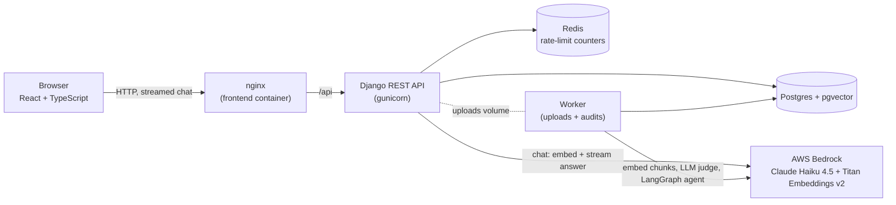

# KB Conflict Auditor + Company Chat

**A company knowledge-base chat that audits its own documents for contradictions before answering from them.**

## The problem
Company chatbots (RAG) answer from whatever documents they are given. Real knowledge bases are messy: an old
policy is never deleted, an FAQ is never updated, two teams write different rules for the same thing.

> `refund-policy-2023.md` says *"refund within 7 days"*, `refund-policy-2025.md` says *"within 3 days"*.
> A normal RAG chatbot may quote either one, confidently.

This project finds those conflicts, suggests which version is the source of truth, and makes the chat use only
the correct passage (or warn when nobody has decided yet).

## What it does
1. **Auditor** (for reviewers): finds **contradictions and duplicates** across all documents, and suggests which
   version is the source of truth. Reviewers confirm or correct each finding.
2. **Chat assistant** (for every employee): answers questions from the documents, streamed word by word, with
   sources, and **uses the audit results**. It skips passages that lost a contradiction, and warns when a topic
   has an unresolved conflict.
3. **Uploads** (for every employee): anyone can upload a Markdown document. It is audited before the chat uses it,
   and a section that conflicts with an existing document is **held** until an auditor decides.

## Architecture

Five Docker Compose services: `db`, `redis`, `backend`, `worker`, `frontend`. Postgres is both the database and the
job queue for the worker; Redis is a shared cache for the rate-limit counters.

## Highlights

**Full-stack engineering**
- **User management API** for an admin role: create / edit / deactivate (soft delete) / lock / unlock, password
  rules, every action logged; **account lockout** after 5 failed logins (auto-unlock after 30 min, row-locked counter).
- Role-based access (admin / auditor / employee) plus **department-level document access enforced in the SQL query**, so
  restricted text never reaches the model for users who may not see it.
- **JWT login** (short-lived access token + refresh token with rotation and a blacklist on logout; the React app
  refreshes expired access tokens automatically), and a per-user chat rate limit **counted in Redis**, so all gunicorn
  processes share one counter (an in-memory counter would be per process and let users through several times over).
- **Streaming chat** (Bedrock ConverseStream → Django streaming response → nginx with buffering off → React).
- **File uploads** with validation, a naming and metadata standard, versioning, and an auditor approve / reject
  workflow.
- **Background worker** using Postgres as a job queue (`SELECT … FOR UPDATE SKIP LOCKED`, plus an advisory lock),
  so the web requests never wait on slow model calls.
- **Observability**: a request ID on every request (nginx → Django → every log line → response header), one JSON
  log line per request and per chat answer with a time breakdown (embed / search / LLM), and `/api/health/` +
  `/api/ready/` (Postgres + Redis) used by the Docker health check.
- **Safe errors**: users see a short message with a reference ID, never internal error text; the full error and
  stack trace are in the server log under the same ID.
- Docker Compose with a multi-stage frontend build, non-root containers, and secrets passed at start-up (never
  baked into images).
- Backend test suite with pytest (no AWS calls needed).

**AI engineering**
- Candidate pairs from **vector search** (top-k per chunk: n·k comparisons instead of n²).
- Decision pipeline, cheapest first: **rule → cache → LLM judge → LangGraph investigator agent** (only for
  "unsure" pairs).
- **Grounding checked by code**: the judge must quote both passages exactly; the chat must cite real passages.
- Source-of-truth **resolver**: explainable rules (status → date → version → document type) before any LLM.
- **Conflict-aware RAG**: retrieval drops outdated and unreviewed conflicting passages, and warns on unresolved
  conflicts instead of giving a confident wrong answer.
- **Evaluation** against a ground-truth answer key with planted conflicts and look-alike traps (recall, precision,
  trap false-alarm rate, resolver accuracy).
- Cost control: verdict cache, reviewer decisions reused across audits, pair limit per run, tokens and cost stored
  per LLM call.

## Tech stack

| Part | Tech |
|---|---|
| LLM + embeddings | AWS Bedrock (boto3 Converse / ConverseStream, region `ap-south-1`): Claude Haiku 4.5 (global inference profile) for the judge, agent and chat; Amazon Titan Text Embeddings v2 (1024 dimensions) |
| Database + vectors | Postgres 16 + pgvector |
| Backend | Django 5.2 + Django REST Framework, session auth, scoped rate limit, gunicorn |
| Agent | LangGraph (only for unclear audit pairs) |
| Frontend | React 18 + TypeScript + Tailwind CSS 4 (Vite), served by nginx |
| Cache | Redis 7 (shared rate-limit counters) |
| Infrastructure | Docker Compose (db, redis, backend, worker, frontend) |

## Quick start (Docker)
```bash
git clone <this-repo-url> kb-conflict-auditor
cd kb-conflict-auditor
cp .env.example .env            # fill in: DB password, Django secret key, AWS keys (Bedrock-only IAM user), model IDs
docker compose up -d --build
docker compose exec backend python manage.py create_demo_users   # auditor, support_agent, ops_agent, finance_staff
docker compose exec backend python manage.py create_admin admin  # user management (asks for a password)
docker compose exec backend python manage.py seed_kb             # loads the sample documents (paid: embeddings)
docker compose exec backend python manage.py run_audit           # first audit (paid: LLM calls)
```
Open http://localhost:8080 and sign in. Full setup, including running without Docker, is below.

---

## Users and roles

| Role | Can do | Chat sees |
|---|---|---|
| **Admin** (group `admin`, or any superuser) | Manage user accounts (create / edit / deactivate / lock / unlock employees and auditors), chat, upload | Live documents open to everyone + **their department** |
| **Auditor** (group `auditor`, or any superuser) | Run audits, review findings, approve / reject new versions, see documents and evaluation, chat, upload | All live documents |
| **Employee** (group `employee`) | Chat, upload documents | Live documents open to everyone + live documents for **their department** |

**Admins** are created only from the command line: `python manage.py create_admin <username> [--department IT]`
(asks for the password), or `createsuperuser`. No admin can be created or changed through the API.

**User management API** (admins only; employees and auditors get 403, anonymous visitors 401):

| Endpoint | What it does |
|---|---|
| `GET /api/users/` | List (50 per page). `?search=` (username / name), `?role=`, `?department=`, `?status=active\|locked\|deactivated`. Deactivated users are listed only with `status=deactivated` |
| `POST /api/users/` | Create an employee or auditor (`username`, `password`, `department`, optional `role`, `first_name`, `last_name`, `email`) |
| `GET /api/users/<id>/` | One user, incl. lock status and failed-login count |
| `PATCH /api/users/<id>/` | Change role (employee / auditor), department, names, email, or set a new password (logs the user out everywhere). The username cannot change |
| `DELETE /api/users/<id>/` | **Deactivate** (soft delete): no login, tokens refused at once; conversations, uploads and decisions are kept |
| `POST /api/users/<id>/reactivate/` | Undo a deactivation |
| `POST /api/users/<id>/lock/` | Admin lock (no end time) + log the user out everywhere |
| `POST /api/users/<id>/unlock/` | End any lock (admin or automatic) and reset the failed-login count |

Passwords must pass Django's standard rules (min 8 characters, not common, not only numbers, not too similar to the
username or name), are stored hashed and are never returned. Every admin action is logged with who did what to whom.

**Account lockout:** 5 wrong passwords in a row (`LOGIN_MAX_FAILED_ATTEMPTS`) lock the account for 30 minutes
(`LOGIN_LOCK_MINUTES`); an admin can unlock it earlier. While locked, even the right password is refused ("This account
is locked…") and the password is not checked, so guessing cannot continue. A correct login resets the count. Someone
else's failed guesses do not log the real user out (their tokens keep working). Trade-off: the "locked" message shows
that the username exists.

Department access comes from the document's front-matter, e.g. `departments: [Customer Support]`.
No `departments` line means everyone can see it. In the test data:
`support-team-playbook.md` → Customer Support, `delivery-partner-handbook.md` → Operations,
`data-retention-policy.md` → Legal, IT.

**Login (JWT):** `POST /api/auth/login/` returns an **access** token (15 min, `JWT_ACCESS_MINUTES`) and a **refresh**
token (8 h, `JWT_REFRESH_HOURS`). The React app keeps them in localStorage and sends `Authorization: Bearer <access>`
on every call, so the API needs no CSRF token. When the access token expires (401), the app calls
`POST /api/auth/refresh/` once and retries; each refresh returns a new refresh token and blacklists the old one.
`POST /api/auth/logout/` blacklists the refresh token. Known limit: an access token keeps working until it expires
(at most 15 min) even after logout. The Django admin page (`/admin`) keeps its own session-cookie login.

Chat is rate-limited per user
(`CHAT_RATE_LIMIT_PER_MIN`) to protect the Bedrock quota. In Docker the counters live in Redis, shared by all
gunicorn processes; on the laptop (one `runserver` process) Django's in-memory cache is used.

---

## How it works

### Auditor
```
 QuickBite docs ──► seed_kb (simulates the chatbot team) ──► KB tables: chunks + vectors (pgvector)
                                                                   │  read-only, through an adapter
                                                                   ▼
 ① candidate pairs   pgvector top-k similar chunks per chunk (n·k pairs instead of n²), only pairs that at least
                     one person can see together; pairs cut by the limit are counted, not silently dropped
                     + pairs with an open finding in the previous audit are always re-checked
 ② rule              exact same text → "duplicate" without an LLM
 ③ cache             same pair + same prompt version + same model judged before → reuse
 ④ LLM judge         Bedrock → JSON label + exact quotes (quotes checked by code)
 ⑤ investigator      only for "unsure": LangGraph agent with tools (neighbour chunks, doc details, search)
 ⑥ resolver          rules (status → date → version → doc type), LLM only if rules can't decide (answer cached)
 ⑦ findings          reviewers choose: A is correct / B is correct / Not a conflict / Ignore.
                     Decisions are saved per pair of TEXTS (fingerprints) and reused by every later audit.
                     A finding that disappears in the next audit is marked "fixed".
 ⑧ evaluation        compare with data/ground_truth.yaml (planted conflicts + traps)
```

### Uploads and conflict gating
```
 upload (.md + form) ─► checks (type, size, UTF-8, required fields, duplicate content)
                     ─► file saved in the "uploads" volume, row saved: state "processing"
 worker              ─► chunk + embed (all sections saved together, or "failed") ─► "awaiting audit"
                     ─► queues ONE audit (or one more after a running one)
 audit finished      ─► new document → "live"     new version of a document → "awaiting approval"
 auditor             ─► Approve (old version becomes superseded) / Reject
```
**Naming and metadata standard for uploads** (`backend/kb/standards.py`, served to the form at `/api/kb/standards/`):

| Field | Rule |
|---|---|
| Name | Set by the system: `uploads/<doc_id>__v<version>.md`, e.g. `uploads/refund-policy__v3.md`. The user can upload a file with any name; the original name is kept for reference. The form shows the final name before upload. |
| `doc_id` | Stable ID for all versions: lowercase letters, digits, hyphens, max 60. New document: made from the title, editable, must be unused. New version: taken from the document it replaces. |
| `version` | Automatic: 1 for a new document, latest + 1 for a new version (rejected numbers are never reused) |
| `title` | Required, max 120 characters |
| `doc_type` | Required: policy, procedure, faq, guide |
| `owner` | Required: one of the departments |
| `effective_date`, `status` | Required; status is active or draft (superseded is set only by an approval) |
| `region`, `audience` | Optional: All / India / UAE; employees / customers / delivery partners. Shown to the judge, so scope differences are not reported as conflicts |

The existing knowledge base (`seed_kb`) keeps its own names and metadata: cleaning it up is the auditor's job.

What the chat does with each audit result:

| Situation | Chat |
|---|---|
| Auditor chose the correct side | Uses only that side |
| New text conflicts with a live text, not reviewed yet | **Holds the new text**, keeps using the live one (an upload can never take a live policy offline) |
| Two new texts conflict | Holds both |
| Two live texts conflict, a **rule** decided (status / date / version / type) | Hides the loser |
| Two live texts conflict, only the **LLM** decided, or nobody could | Uses both and **warns** (an LLM mistake must never hide the correct policy) |
| Reviewer said "not a conflict" / "ignore" | Uses both normally |

The held state is remembered per pair of texts, so it survives later audits until an auditor decides.
See `docs/DECISIONS.md` for why each rule is the way it is.

### Chat
```
 question ─► embed (Bedrock) ─► pgvector search, ONLY in live, not superseded documents this user may see
          ─► drop passages that LOST a contradiction, and HELD passages (new, not reviewed)
          ─► warn if a passage is part of an UNRESOLVED contradiction
          ─► passages carry effective date, version and status; if they still disagree, the model must
             say so and show both (prompt chat-v2) instead of picking one silently
          ─► answer streamed word by word (Bedrock ConverseStream), citing [1] [2]
          ─► code checks every [n] points to a real passage; answer + sources saved per user
```
No relevant passage → the model is **not called** and the user gets "I could not find this…".

### Key design decisions (interview talking points)
1. **Pipeline first, agent only where needed.** Most pairs are decided by one judge call; only "unsure" pairs go to the agent.
2. **High similarity ≠ duplicate.** "7 days" vs "3 days" is almost identical text, so near-identical pairs are the *most* suspicious.
3. **n² → n·k.** Candidate pairs come from the vector index (top-k per chunk), not all-pairs comparison.
4. **Grounding checked by code.** The judge must quote both passages exactly; the chat must cite real passage numbers.
5. **Rules before LLM for "which is true".** Cheap, predictable, explainable; "unknown" is allowed.
6. **The audit makes the chat safer.** Losing passages are removed from retrieval, and unresolved conflicts produce a warning instead of a confident wrong answer.
7. **Access control at retrieval time.** The department filter is in the SQL query, so restricted text never reaches the model for users who may not see it.
8. **Adapter for the knowledge base.** Another vector store = one new adapter class.
9. **Cost control.** Verdict cache, reviewer suppression, max pairs per run, chat rate limit, no LLM call when nothing relevant is found, tokens and $ stored per verdict and per chat message.
10. **Postgres as a job queue** for uploads and audits (`SELECT … FOR UPDATE SKIP LOCKED`, plus an advisory lock so
    at most one audit waits in the queue); Celery/SQS at larger scale.
11. **Uploads are gated, not trusted.** Metadata typed by an uploader (e.g. today's date) can never make a new
    document win automatically; a replacement always needs an auditor's approval.
12. **Decisions are tied to text, not IDs.** Fingerprints (content hashes) keep reviewer decisions and held texts
    valid across re-loads; when a text changes, the old decision stops applying, which is correct.

More detail and trade-offs: [`docs/DECISIONS.md`](docs/DECISIONS.md).

### Observability
| What | Where |
|---|---|
| Request ID | nginx creates it (`X-Request-ID`), Django reuses it (or makes one), adds it to every log line and sends it back in the `X-Request-ID` response header |
| Logs | One JSON object per line on the console (`docker compose logs backend`). Level: `LOG_LEVEL` (default `INFO`) |
| Per request | `method`, `path`, `status`, `duration_ms`, `user_id` |
| Per chat answer | `embed_ms`, `search_ms`, `conflicts_ms`, `llm_ms`, `total_ms`, passages used / dropped, tokens, cost, `failed` |
| Errors | The user sees "an internal error happened (reference: …)"; the log has the full error and stack trace under that reference |
| `/api/health/` | The app process is running |
| `/api/ready/` | Postgres and Redis are reachable (200, or 503 naming the failed check). Used by the Docker health check |

Follow one request through the logs (PowerShell), using the reference shown to the user or the `X-Request-ID` header:
```powershell
docker compose logs backend | Select-String 7f3a2c9e1b4d
```

---

## Folder layout

```
kb-conflict-auditor/
├── docker-compose.yml          db + redis + backend + worker + frontend (or just db)
├── .env.example                copy to .env and fill in
├── .dockerignore               keeps .env, venv, node_modules out of images
├── docs/DECISIONS.md           design decisions, trade-offs, known limits
├── data/
│   ├── quickbite_docs/         20 fake company documents (Markdown + front-matter, some with departments)
│   ├── upload_samples/         2 small documents to try the upload flow (a policy and an FAQ that disagree)
│   └── ground_truth.yaml       answer key: 13 contradictions, 4 duplicates, 13 traps
├── backend/
│   ├── config/                 Django settings + urls
│   ├── core/                   plain-Python logic (no Django): bedrock_client, chunking, kb_adapter, candidates,
│   │                           prompts, judge, investigator (LangGraph), resolver, chat
│   ├── accounts/               roles (groups), departments, login API, create_demo_users
│   ├── kb/                     the SIMULATED company knowledge base: seed_kb, upload API, document life cycle
│   ├── audit/                  the auditor: models, pipeline runner, evaluation, API (auditors only),
│   │                           commands: check_bedrock, run_audit, run_worker, evaluate
│   ├── chat/                   conversations, messages, streaming answer endpoint
│   ├── tests/                  unit tests (no AWS) + permission tests (need the database)
│   ├── Dockerfile              backend + worker image (gunicorn)
│   └── entrypoint.sh           web: migrate + collectstatic + gunicorn | worker: run_worker
└── frontend/                   React UI: Login, Chat, Upload, Findings, Finding detail, Runs, Documents, Evaluation
    ├── Dockerfile              build with Node, serve with nginx
    └── nginx.conf              serves the UI, forwards /api + /admin, no buffering for streaming
```

---

## Two ways to run it

| | Option A: on the laptop | Option B: everything in Docker |
|---|---|---|
| Needs | Docker (DB only), Python 3.13, Node 22 | Docker only |
| Servers | `runserver` + Vite dev server | gunicorn + nginx (production-like) |
| Open | http://localhost:5173 | http://localhost:8080 |
| Best for | Changing and debugging code | Demo, "it's containerized" |

---

## Option B: everything in Docker (production-like)

```
docker compose up
   ├── db        Postgres + pgvector
   ├── redis     shared cache: chat rate-limit counters for all gunicorn processes
   ├── backend   Django API on gunicorn (runs migrations on start)
   ├── worker    processes uploads (chunk + embed) and audits (button, uploads, seed_kb)
   │             uploaded files live in the "uploads" volume, shared by backend and worker
   └── frontend  nginx: serves the React build, forwards /api and /admin to the backend
                 (buffering off, so chat answers still stream word by word)
```

**1. Settings.** `copy .env.example .env`, then fill in: `POSTGRES_PASSWORD`, `DJANGO_SECRET_KEY`,
`AWS_ACCESS_KEY_ID`, `AWS_SECRET_ACCESS_KEY` (an IAM user that may only call Bedrock), `CHAT_MODEL_ID`,
`EMBED_MODEL_ID`, `EMBED_DIM` (see Option A step 3 for choosing models).
`.env` is never copied into an image; Docker passes the values to the containers when they start.
Do not share the output of `docker compose config`, because it prints these values.

**2. Build the backend image and create the migration files (one time).**
Skip this if you already ran `makemigrations` in Option A.
```powershell
cd kb-conflict-auditor
docker compose build backend
docker compose run --rm -v ./backend:/app/backend backend python manage.py makemigrations accounts kb audit chat
```
The `-v` makes the new migration files appear in your `backend/` folder, so they are part of the next build.

**3. Start everything.**
```powershell
docker compose up -d --build
docker compose ps          # db, redis, backend, worker, frontend should be running (backend "healthy")
```

**4. Users, data and the first audit** (commands run inside the backend container):
```powershell
docker compose exec backend python manage.py createsuperuser
docker compose exec backend python manage.py create_demo_users
docker compose exec backend pytest
docker compose exec backend python manage.py check_bedrock      # 2 tiny paid calls
docker compose exec backend python manage.py seed_kb            # paid: embeddings
docker compose exec backend python manage.py run_audit --evaluate   # paid: LLM calls
```

**5. Open** http://localhost:8080 (admin page: http://localhost:8080/admin).

**Everyday commands**
| Task | Command |
|---|---|
| See logs | `docker compose logs -f backend worker` |
| After changing code | `docker compose up -d --build` |
| Stop (data is kept) | `docker compose down` |
| Stop and **delete the database and uploaded files** | `docker compose down -v` |
| Only the database (for Option A) | `docker compose up -d db` |

How many people can use it at once is set by `GUNICORN_WORKERS` x `GUNICORN_THREADS` (default 2 x 8 = 16 requests
at the same time, including streaming chats). In practice the Bedrock quota is usually the real limit, which is why
there is a per-user chat rate limit.

---

## Option A: run on the laptop (Windows PowerShell)

### 1. Settings file
```powershell
cd kb-conflict-auditor
copy .env.example .env
```
Open `.env` and set at least `POSTGRES_PASSWORD` and `DJANGO_SECRET_KEY`. Model IDs come in step 3.

### 2. Start Postgres (Docker Desktop must be running)
```powershell
docker compose up -d db
docker compose ps        # kb_auditor_db should be running
```
AWS access comes only from the keys in `.env` (`AWS_ACCESS_KEY_ID`, `AWS_SECRET_ACCESS_KEY`); AWS CLI profiles are not used.

### 3. Choose models available in Mumbai
These commands only **list** models; they change nothing:
```powershell
aws bedrock list-foundation-models --region ap-south-1 --query "modelSummaries[].modelId" --output table
aws bedrock list-inference-profiles --region ap-south-1 --query "inferenceProfileSummaries[].inferenceProfileId" --output table
```
- **One embedding model** → `EMBED_MODEL_ID`, and set `EMBED_DIM` to its vector size.
- **One small chat model that supports tool use and streaming in the Converse API** → `CHAT_MODEL_ID`
  (use the inference profile ID if the model is only offered through one).
- Enable **model access** for both in the Bedrock console (region Mumbai).
- Optional: `CHAT_PRICE_INPUT_PER_1K` / `CHAT_PRICE_OUTPUT_PER_1K` from the Bedrock pricing page, to see costs.

### 4. Python environment
```powershell
cd backend
python -m venv venv
.\venv\Scripts\Activate.ps1
pip install -r requirements.txt
```

### 5. Create the tables and users
```powershell
python manage.py makemigrations accounts kb audit chat
python manage.py migrate
python manage.py createsuperuser        # you: full access + the admin page
python manage.py create_demo_users      # asks for one password; creates:
                                        #   auditor (Legal), support_agent (Customer Support),
                                        #   ops_agent (Operations), finance_staff (Finance)
```
More users: create an admin (`python manage.py create_admin <username>`), who then manages employees and auditors
through `/api/users/`; or http://127.0.0.1:8000/admin → Users → add user → then set **Groups** (admin / auditor /
employee) and **Department**.

### 6. Tests (no AWS calls; Postgres must be running)
```powershell
pytest
```

### 7. Check the Bedrock connection (2 tiny paid calls)
```powershell
python manage.py check_bedrock
```

### 8. Build the "company knowledge base" (paid: one embedding per chunk, ~60 chunks)
```powershell
python manage.py seed_kb
```

### 9. Run an audit + evaluation (paid: one chat call per candidate pair, plus investigations)
```powershell
python manage.py run_audit --evaluate
python manage.py evaluate --details
```
Run the audit **before** testing the chat: the chat uses the latest finished audit to skip outdated passages.

### 10. Start the app
Terminal 1 (API): `cd backend; .\venv\Scripts\Activate.ps1; python manage.py runserver`
Terminal 2 (worker: uploads and audits): `cd backend; .\venv\Scripts\Activate.ps1; python manage.py run_worker`
(on the laptop, uploaded files are saved in the `uploads/` folder of the project; it is in `.gitignore`)
Terminal 3 (frontend):
```powershell
cd frontend
npm install
npm run dev
```
Open http://localhost:5173 and sign in.

### Things to try
| Sign in as | Ask / do | Expected |
|---|---|---|
| `support_agent` | "How many days do customers in India have to request a refund?" | "3 days" with a source from `refund-policy-2025.md`; the 2023 passage listed as skipped |
| `support_agent` | "Which ticketing tool do we use?" | Freshdesk (support playbook is visible to Customer Support) |
| `finance_staff` | "Which ticketing tool do we use?" | Cannot see the support playbook; the onboarding guide's "Zendesk" passage is skipped as outdated (if the audit found that conflict) → "could not find" |
| `support_agent` | "When is customer care available?" | Warning that documents disagree, **if** the resolver could not pick a side for the two FAQs (they have no metadata) |
| `ops_agent` | open http://localhost:5173/findings | Redirected to Chat (API returns 403) |
| `auditor` | Findings / Runs / Evaluation | Full access |
| `support_agent` | Upload a `.md` saying "refund within 10 days" (India, active, today's date) | Upload → processing → awaiting audit → live. The audit reports a conflict with the 2025 policy; the "10 days" section is **held**; the chat still answers "3 days" and lists the new section as skipped |
| `auditor` | On that finding click "B is correct" (the upload) | The chat now answers "10 days" and skips the 2025 section |
| `support_agent` | Upload a new version of the Refund Policy ("Replaces") | State "awaiting approval"; the old version is still used until the auditor approves it on the Documents page |

The `finance_staff` row is a good interview story: the onboarding guide still says "Zendesk". The auditor marks that passage as outdated, so the chat skips it. A user who cannot see the newer playbook gets "could not find" instead of a confident wrong answer.

---

## Evaluation: what the numbers mean

| Metric | Question it answers |
|---|---|
| `candidate_recall` | Did the planted pair even reach the judge? If not, tune `CANDIDATE_TOP_K` / `CANDIDATE_MIN_SIMILARITY`. |
| `recall` | Of the planted contradictions + duplicates, how many became findings? |
| `precision` | Of all findings, how many were correct? Trap false alarms and findings not in the answer key count against it. |
| `trap_false_alarm_rate` | How many traps (different region / audience / exception / same meaning) were wrongly reported? |
| `resolver_accuracy` | For found contradictions, was the suggested source of truth right? |
| `cost_usd`, `duration_seconds` | What one run costs and how long it takes. |

The chat has no automatic evaluation yet (next step: a small question set with expected answers and sources).

---

## Known limitations / next steps
- Markdown only (PDF extraction is a separate problem).
- Embedding calls (chat questions, investigator search) are not included in the cost totals.
- A run left in `running` after a crash is not resumed automatically (mark it `failed` in the admin).
- Option A uses development servers. Option B uses gunicorn + nginx but is still a local setup: real hosting would
  add HTTPS, a managed database (e.g. RDS with pgvector), secrets in a secrets manager or an IAM role instead of keys
  in `.env`, a connection pool, and Celery/SQS for audits.
- Department access is per document, not per section.
- Pairs of documents that no single person can see together (e.g. Operations-only vs Finance-only) are not audited.
- Uploads: Markdown only, no upload rate limit, approvals do not record who approved.
- Next: chat evaluation set, stale-reference detection, "condition split across chunks" findings,
  routing hard pairs to a bigger model, source connectors (S3 / Confluence), scheduled audits.
